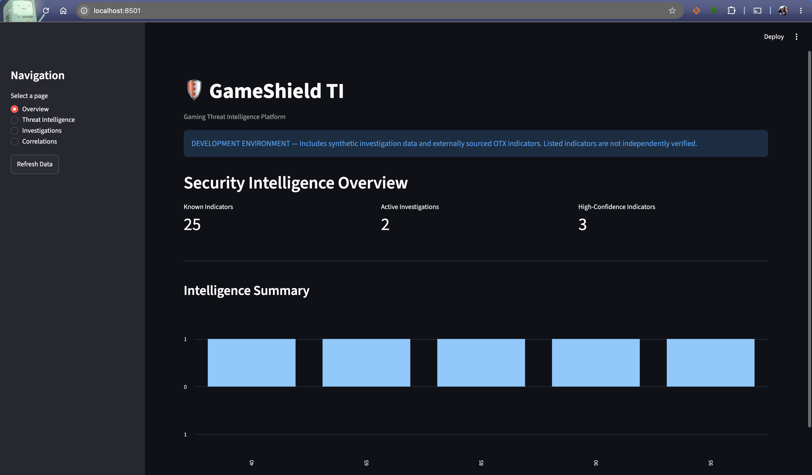
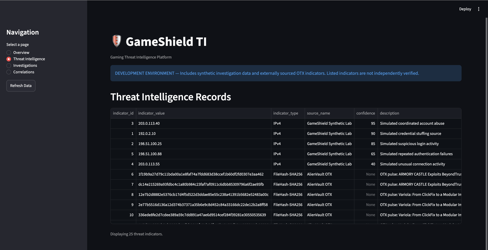
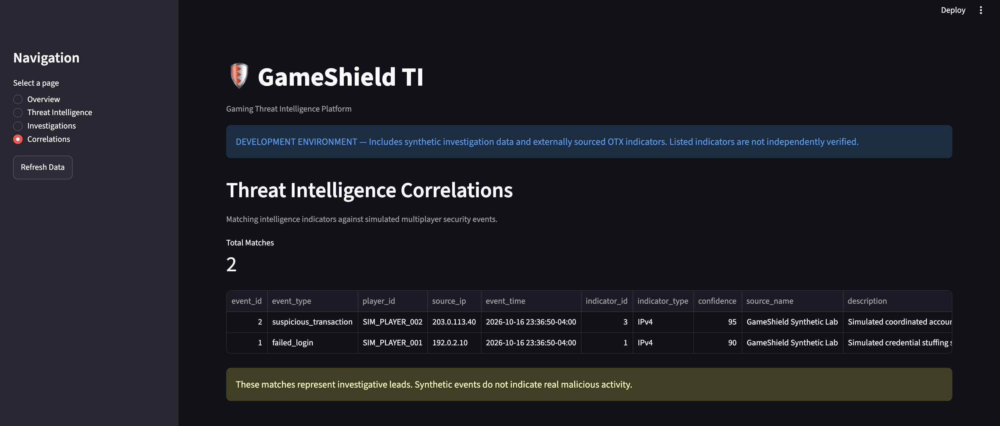
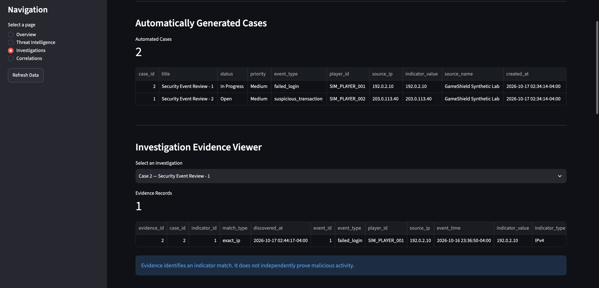
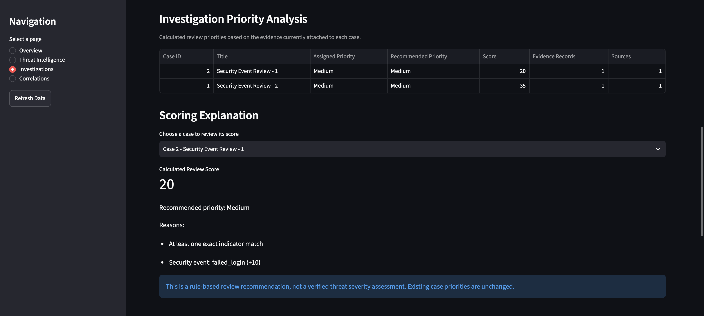
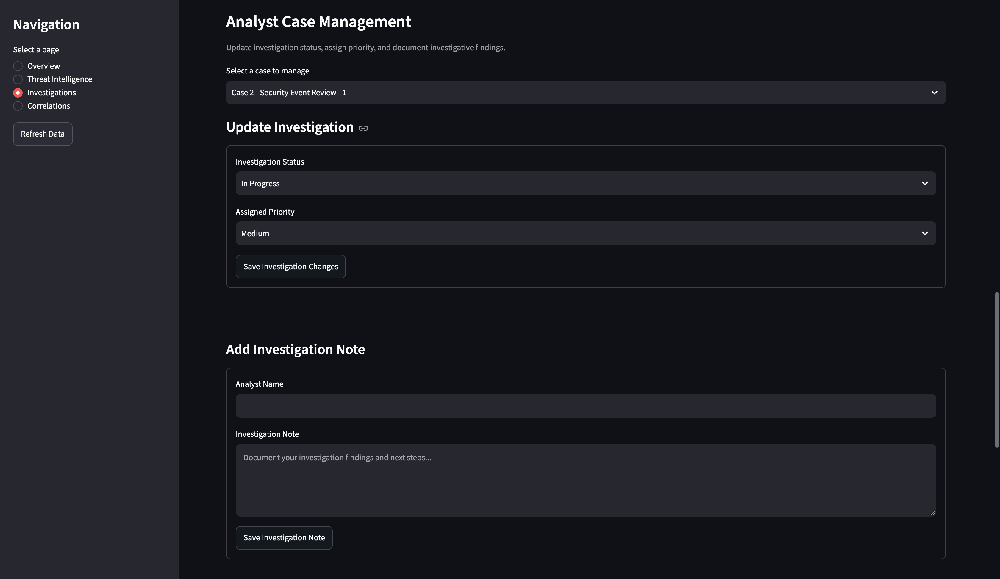
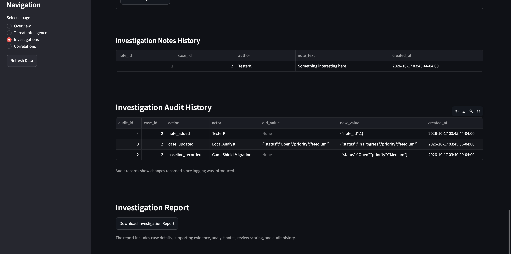

# GameShield TI
### Gaming Threat Intelligence & Digital Investigation Platform

GameShield TI is a Python-based cybersecurity portfolio project
designed to demonstrate threat intelligence collection, security
event correlation, digital investigation workflows, and
evidence-driven case management in a simulated multiplayer
gaming environment.

The platform integrates public threat intelligence from AlienVault
Open Threat Exchange (OTX) with synthetic game-security events.

> Development project only. Game-security events and player
> accounts are synthetic. External indicators are not independently
> verified. This platform is not production-ready.

## Key Features

- Threat intelligence ingestion using the AlienVault OTX API
- PostgreSQL storage of indicators and intelligence sources
- Correlation between stored IP indicators and security events
- Automated generation of investigation cases
- Evidence tracking across multiple intelligence sources
- Explainable, rule-based review-priority recommendations
- Analyst case status and priority management
- Investigation notes and database-backed audit history
- Downloadable Markdown investigation reports
- Automated testing with pytest
- Streamlit investigation dashboard

## Technology Stack

| Technology | Purpose |
|---|---|
| Python | Backend logic and automation |
| PostgreSQL | Relational database |
| Streamlit | Interactive dashboard |
| Pandas | Data analysis and visualization |
| Requests | Threat intelligence API integration |
| Psycopg | PostgreSQL database connectivity |
| Pytest | Automated testing |
| Git and GitHub | Version control |

## Architecture

See [Architecture Documentation](docs/ARCHITECTURE.md).

## Dashboard


## Dashboard Screenshots

### Security Intelligence Overview



### Threat Intelligence



### Correlation Engine



### Investigations



### Review Priority Analysis



### Analyst Case Management



### Audit Trail and Reporting




## Installation

### Prerequisites

- Python 3.11 or newer
- PostgreSQL
- Git
- An AlienVault OTX API key for live collection

### Clone the Repository

```bash
git clone https://github.com/KentrellZeigler/gameshield-ti.git
cd gameshield-ti
```

### Create a Python Environment

```bash
python3 -m venv .venv
source .venv/bin/activate
python -m pip install -r requirements.txt
```

### Configure Environment Variables

```bash
cp .env.example .env
```

Edit `.env` to configure your local database and OTX API key.

Never commit actual API credentials.

### Create the Database

```bash
createdb gameshield_ti
./scripts/setup_database.sh gameshield_ti
```

### Load Synthetic Demonstration Data

```bash
psql -v ON_ERROR_STOP=1 -d gameshield_ti \
  -f src/database/seed.sql
```

### Run the Dashboard

```bash
python -m streamlit run app.py
```

### Collect Public Threat Intelligence

```bash
python -m src.collectors.run_otx_ingestion
```

### Generate Investigation Cases

```bash
python -m src.analyzers.case_generator
```

### Run Automated Tests

Create a separate test database:

```bash
createdb gameshield_ti_test
./scripts/setup_database.sh gameshield_ti_test
python -m pytest tests/ -v
```

## Investigation Workflow

1. Collect and normalize published intelligence indicators.
2. Store indicators with their sources in PostgreSQL.
3. Compare indicators against synthetic game-security events.
4. Generate cases from exact indicator matches.
5. Attach matching indicators as evidence.
6. Calculate explainable review-priority recommendations.
7. Document investigative findings and case changes.
8. Export an investigation report.

## Security Considerations

The platform uses parameterized database queries, local secret
configuration, database constraints, and isolated test data.

It does not currently provide authentication, authorization,
verified analyst identity, or tamper-resistant audit storage.

Do not expose the case-management application publicly.

See [Security Documentation](docs/SECURITY.md).

## Project Limitations

- Simulated game-server activity
- Rule-based scoring rather than calibrated threat risk
- One generated case per security event
- Limited indicator types and intelligence sources
- No production authentication or role-based access
- No independently verified malicious behavior
- No production deployment or availability guarantees

## Future Improvements

- Related-event investigation grouping
- Confidence and source reliability modeling
- Threat intelligence freshness management
- STIX/TAXII support
- Authentication and role-based access control
- Additional intelligence enrichment sources
- Scheduled collection and monitoring
- Improved reporting and metrics

## License

No license has been selected yet.

## Disclaimer

GameShield TI is an independent educational portfolio project.
It is not affiliated with, endorsed by, or used by Rockstar Games.
```
