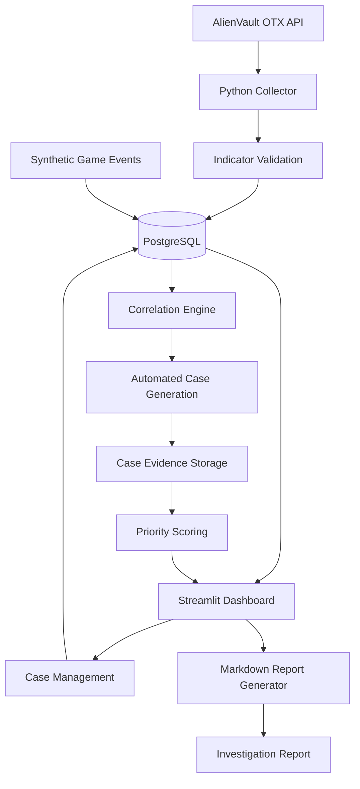

# GameShield TI — System Architecture

## Overview

GameShield TI separates data collection, persistence,
analysis, case management, and presentation.

## Architecture Diagram



## Main Components

### Intelligence Collection
Location: `src/collectors/`

Retrieves public intelligence indicators from AlienVault OTX.

### Database Layer
Location: `src/database/`

Provides PostgreSQL connections, database queries,
indicator ingestion, schema creation, and migrations.

### Correlation Engine
Location: `src/analyzers/correlation.py`

Performs exact IP matching between security events
and stored threat indicators.

### Investigation Engine
Location: `src/analyzers/case_generator.py`

Creates automated cases and preserves associated evidence.

### Review Priority Engine
Location: `src/analyzers/priority_engine.py`

Calculates an explainable review recommendation
using rule-based event weights.

### Case Management
Location: `src/analyzers/case_management.py`

Supports updates, notes, and recorded case history.

### Report Generation
Location: `src/reports/report_generator.py`

Exports investigation details as Markdown reports.

### User Interface
Location: `app.py`

Provides the Streamlit dashboard.

## Data Limitations

The game-security events are synthetic.
Intelligence indicators are externally sourced but
are not independently verified.

Matching an indicator does not establish malicious intent.

## Architecture Limitations

The current application uses one automated case per
security event rather than grouping related incidents.

The database and interface are intended for local development.
No authenticated multiuser access is implemented.
```
